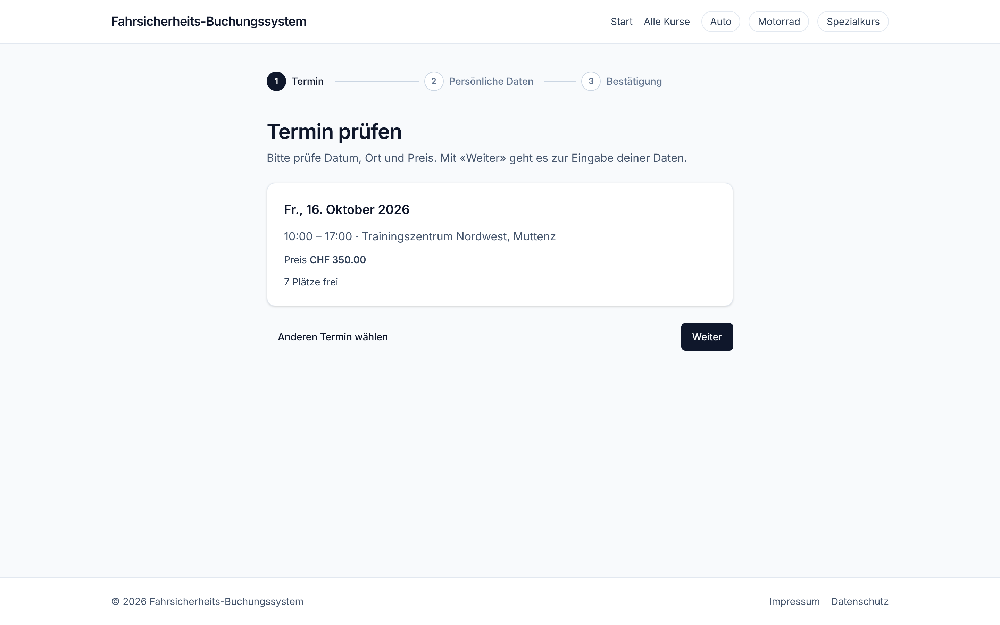
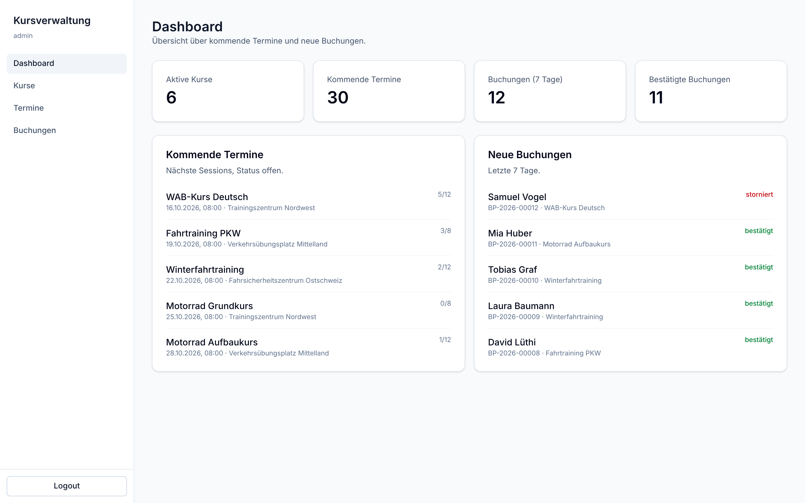
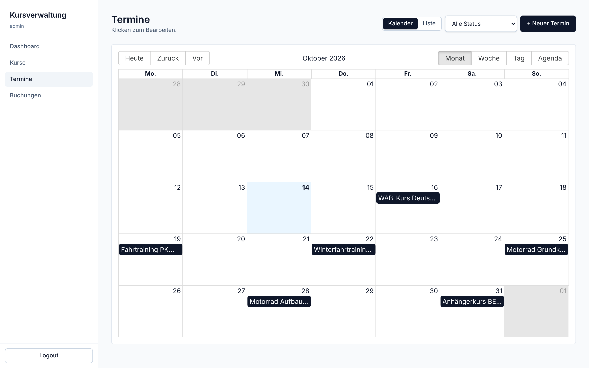
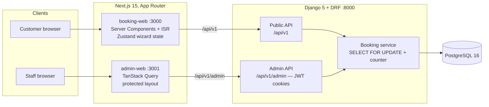

# Driver Safety Course Booking

[](https://github.com/maxikrueger/course-booking-system/actions/workflows/ci.yml)


**A booking platform for driver safety training: a three-step booking wizard for
customers and a protected admin UI for courses, dates and bookings.**

Customers browse courses by category, pick a date at a training centre and book a
seat in three steps, no account required. Staff manage the catalogue, schedule
sessions, watch capacity and export participant lists from a separate admin app.
Seats are the scarce resource, so the last free seat is handed out under a row
lock: two people clicking "book" at the same millisecond produce one booking and
one honest "fully booked".

The product language is German (Swiss market); the engineering documentation is English.



<table>
  <tr>
    <td></td>
    <td></td>
  </tr>
  <tr>
    <td align="center"><sub>Admin dashboard: capacity and recent bookings at a glance</sub></td>
    <td align="center"><sub>Session calendar, with a list view as the mobile fallback</sub></td>
  </tr>
</table>

## Features

- **Three-step booking wizard** (date → personal data → confirmation) with the
  draft auto-saved on every keystroke, so a reload mid-form loses nothing
- **Race-condition-safe booking**: `SELECT FOR UPDATE` on the session row inside one
  transaction, verified by a test that fires two real parallel bookings at the last seat
- **Human-readable booking numbers** (`BP-2026-00042`) from an atomic per-year counter,
  never the database id
- **Admin UI** with full CRUD for courses, sessions and bookings, a session calendar,
  capacity guards and a CSV participant export (UTF-8 BOM, so Excel gets the umlauts right)
- **Admin auth on httpOnly JWT cookies** with refresh-token rotation, blacklisting
  and a rate limit of 5 login attempts per minute per IP
- **Translation tables instead of `title_de` / `title_en` columns** — DE is live,
  EN/FR are editable in the admin and ship the day they are needed
- **Server-first frontend**: public pages render on the server with ISR, so the
  booking page is cheap to serve and scores 100 for performance, accessibility and
  best practices in Lighthouse
- **Accessibility as a test, not a promise**: axe-core runs over eight pages in CI-ready
  Playwright specs, at WCAG 2.1 A/AA

## Architecture



Three deployable apps against one database. The public API is anonymous and
cacheable; the admin API is cookie-authenticated and never indexed. Both reach the
database through the same booking service, so a seat booked from the wizard and a
seat booked from the admin obey the same capacity rules.
More detail in [docs/ARCHITECTURE.md](docs/ARCHITECTURE.md).

## Tech stack

| Layer | Technology |
|---|---|
| Backend | Python 3.12, Django 5, Django REST Framework, `uv` |
| Database | PostgreSQL 16, row-level locking for capacity |
| Auth | SimpleJWT in httpOnly cookies, rotation + blacklist, `django-ratelimit` |
| Frontend | Next.js 15 (App Router, Server Components, ISR), TypeScript strict, Tailwind CSS 4 |
| State / data | TanStack Query, Zustand (wizard state persisted to localStorage) |
| Forms | react-hook-form + Zod, shared schema per wizard step |
| i18n | `next-intl` (DE active), translation tables in the backend (DE/EN/FR) |
| Tests | pytest + pytest-django (47), Vitest (12), Playwright incl. axe-core (23) |
| Quality | ruff, mypy `--strict`, ESLint, Prettier, pre-commit hooks |
| CI | GitHub Actions: lint, types, tests on PostgreSQL; E2E on pull requests |

## Quick start

Requirements: Git, Make, Node ≥ 22.13, pnpm ≥ 11, [`uv`](https://docs.astral.sh/uv/),
and either Docker (for the bundled PostgreSQL) or a PostgreSQL 16 of your own.

```bash
git clone https://github.com/maxikrueger/course-booking-system.git
cd course-booking-system

make setup       # check tools, create .env files, uv sync, pnpm install
make db-up       # PostgreSQL 16 via Docker Compose
make seed        # demo catalogue: 3 categories, 6 courses, 3 venues, 20+ sessions
make dev         # backend :8000, booking-web :3000, admin-web :3001
```

| URL | What |
|---|---|
| <http://localhost:3000> | public booking site |
| <http://localhost:3001> | admin UI |
| <http://localhost:8000/api/v1/> | REST API root |
| <http://localhost:8000/admin/> | Django admin (fallback) |

The admin UI needs a user. `cd apps/backend && uv run python manage.py create_admin`
creates `admin` with the development password `admin123` — but only while `DEBUG=True`.
With `DEBUG=False` the command refuses to run unless `--password` or
`DJANGO_ADMIN_PASSWORD` is set, so no deployed instance ever starts with a known password.

Running the DB without Docker: point `DATABASE_URL` in `apps/backend/.env` at your own
PostgreSQL and skip `make db-up`.

## Quality checks

The same commands CI runs:

```bash
make lint        # ruff format --check, ruff check, eslint
make typecheck   # mypy --strict, tsc --noEmit
make test        # pytest (SQLite, fast) + race-condition test (PostgreSQL) + vitest
```

End-to-end tests need a running stack and a browser, so they stay out of `make test`:

```bash
cd apps/booking-web && pnpm test:e2e          # booking flow, mobile, axe
cd apps/admin-web   && pnpm test:e2e          # login, CRUD, layout, axe
```

Scores and audit results: [docs/QUALITY.md](docs/QUALITY.md).

## Design decisions

- **The database decides who gets the last seat.** Availability is never computed in
  application code and then trusted: the booking transaction locks the session row,
  counts confirmed bookings and either inserts or rejects. A dedicated test runs two
  real threads at a one-seat session and asserts exactly one winner.
- **Booking numbers come from a counter table, not `max(id) + 1`.** A per-year row is
  locked and incremented in the same transaction, so numbers stay gap-free and unique
  under concurrency.
- **Tokens live in httpOnly cookies.** An admin UI is a prime XSS target; tokens in
  `localStorage` are readable by any injected script. The cookie is set by the backend,
  never touched by JavaScript, and refresh rotates with the old token blacklisted.
- **Translations are rows, not columns.** `CourseTranslation` keeps the schema stable
  when a language is added, and the admin edits all languages in one request.
- **Server Components by default.** Course lists and detail pages render on the server
  with `revalidate`, so the public site ships little JavaScript; `'use client'` is
  reserved for the wizard and the admin's interactive views.
- **Fast tests stay fast.** The suite runs on SQLite in ~1 s; only the tests that need
  real row locking run against PostgreSQL.

The full set, with the alternatives weighed: [docs/DECISIONS.md](docs/DECISIONS.md).

## Known limitations

- Payment, e-mail confirmations and customer accounts are deliberately out of scope;
  the data model leaves room for them but nothing is wired up.
- Only German is active in the public frontend. EN/FR translations can be entered and
  are served over the API, but no language switcher ships yet.
- No `/health` endpoint yet; uptime monitoring has to poll `/api/v1/courses/`.
- Cancelling a session marks its bookings cancelled but notifies nobody — that needs
  the e-mail layer.
- Frontend unit test coverage is thin (12 tests); the behavioural safety net is the
  Playwright suite.

## Project structure

```
apps/
  backend/            Django 5 + DRF
    courses/          categories, courses, locations, sessions, i18n helpers
    bookings/         booking model, number counter, race-safe create endpoint
    admin_api/        JWT cookie auth, admin CRUD, stats, CSV export
    backend/settings/ base / dev / test / test_pg
  booking-web/        Next.js public site: catalogue + three-step wizard
  admin-web/          Next.js admin UI: dashboard, CRUD, calendar
docs/                 architecture, API, decisions, deployment, quality
scripts/              tool checks, .env sync, parallel dev runner
.github/workflows/    CI: backend, frontends, E2E on pull requests
```

## License

[MIT](LICENSE)
