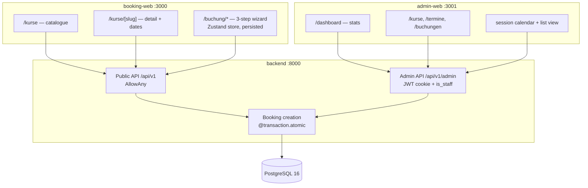
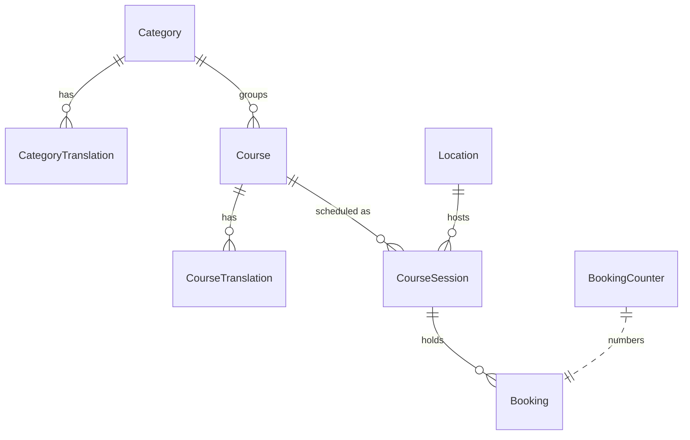

# Architecture

Three deployable applications share one PostgreSQL database:

| App | Port | Audience | Rendering |
|---|---|---|---|
| `apps/backend` | 8000 | both frontends | Django 5 + DRF, JSON only |
| `apps/booking-web` | 3000 | customers, public | Next.js 15, Server Components + ISR |
| `apps/admin-web` | 3001 | staff, authenticated | Next.js 15, client-side queries behind a protected layout |

They are split because they have genuinely different requirements. The public site
is anonymous, cacheable and SEO-relevant; the admin UI is interactive, never indexed,
and authenticated on every request. Keeping them apart means the public bundle carries
no admin code and the admin can be firewalled or moved behind a VPN without touching
the booking site.



## Data model



| Entity | Purpose | Notable fields |
|---|---|---|
| `Category` | navigation level: car, motorcycle, special | `slug`, `order`, `is_active` |
| `Course` | reusable course definition, price and duration | `base_price_chf`, `duration_hours` |
| `CourseTranslation` | per-language title and descriptions | unique on `(course, language)` |
| `Location` | training venue with address and coordinates | `slug`, `name`, `latitude/longitude` |
| `CourseSession` | one dated run of a course at a venue | `start_datetime`, `max_participants`, `price_chf`, `status` |
| `Booking` | one participant on one session | `booking_number`, contact + address, `status` |
| `BookingCounter` | per-year sequence behind booking numbers | `year`, `current_value` |

Rules that live in the schema rather than in application code:

- `CheckConstraint` — a session's `end_datetime` must be after its `start_datetime`.
- `UniqueConstraint` on `(course, language)` and `(category, language)` — one translation
  per language, enforced by the database.
- `Index` on `(start_datetime, status)` — the calendar and "upcoming sessions" queries
  both filter on exactly that pair.
- `on_delete=PROTECT` from `CourseSession` to `Course` and `Location` — a venue with
  history cannot be deleted by accident; deleting a course with booked sessions returns
  `409 Conflict` instead of cascading.

`available_spots` and `is_bookable` are properties, not columns. A denormalised counter
would be one more thing to keep in sync, and the authoritative count is cheap:
confirmed bookings for one session, behind an index.

## Translations as rows

Course and category texts live in `CourseTranslation` / `CategoryTranslation` rows keyed
by language, not in `title_de` / `title_en` columns. Adding French is then an insert, not
a migration, and the admin can edit every language of a course in a single request.

The two API layers read the same tables differently:

- **Public API** resolves one language per request. `Accept-Language` picks it,
  `de` is the fallback, and the client sees a flat `title` string.
- **Admin API** returns `translations` as a dictionary of all languages at once, because
  the course form renders one tab per language.

German is required on write; the other languages are optional and language-additive —
leaving a tab empty does not create an empty translation, and clearing a previously
filled tab deletes that row.

## Booking under concurrency

The interesting constraint of the whole system: seats are finite, and two people can
click "book" on the last one at the same instant.

```python
with transaction.atomic():
    session = CourseSession.objects.select_for_update().get(pk=session_id)
    if session.status != "open":
        raise SessionNotOpenError(session.status)
    if session.start_datetime <= timezone.now():
        raise ValidationError(...)
    if session.bookings.filter(status="confirmed").count() >= session.max_participants:
        raise SessionFullError()
    Booking.objects.create(session=session, ...)   # number assigned here
```

`SELECT FOR UPDATE` holds a row lock on the session until the transaction commits. The
second request blocks at the `get()`, then re-reads the count *after* the first booking
is committed and gets an honest `session_full`. Availability is never read, released and
then trusted.

The booking number is generated inside the same transaction:
`BookingCounter.next_value(year)` locks the counter row for the year, increments it and
returns `BP-2026-00042`. The number is therefore unique and gap-free under concurrency,
and it is not the primary key — database ids leak how much business you do and change
when data is migrated.

`bookings/tests/test_race_condition.py` runs two real threads against a one-seat session
on PostgreSQL and asserts exactly one `201` and one `400 session_full`. It runs against
PostgreSQL specifically because SQLite has no meaningful row locking — see
[DECISIONS.md](DECISIONS.md).

## Authentication

Only the admin API is authenticated. The flow:

1. `POST /api/v1/admin/auth/login/` verifies the credentials and `is_staff`, then sets
   the access and refresh tokens as **httpOnly cookies**. The response body carries only
   the user object — no token ever reaches JavaScript.
2. A custom DRF authentication class reads the access cookie instead of the
   `Authorization` header.
3. `POST /auth/refresh/` rotates: a new refresh token is issued and the old one is
   blacklisted, so a stolen refresh token stops working the moment the real session
   refreshes.
4. `POST /auth/logout/` blacklists the refresh token and clears both cookies.

Login is rate-limited to 5 attempts per minute per IP (`django-ratelimit`, disabled in
tests via a dummy cache). The admin frontend keeps no auth state of its own: a protected
layout calls `/auth/me/` server-side and redirects to `/login` when the cookie is gone.

## Frontend composition

**booking-web** is server-first. The catalogue, course detail and date pages are Server
Components that fetch from the API with `revalidate`, so repeat visitors are served from
the ISR cache and the JavaScript payload stays small. Only the wizard is a client
component, because it owns form state.

The wizard keeps its draft in a Zustand store persisted to `localStorage`, written on
every `form.watch()` change rather than on step transitions — a reload halfway through
typing an address loses nothing. Validation stays at the step boundary, where Zod
schemas (shared with react-hook-form) decide whether "next" is allowed.

**admin-web** is the opposite: TanStack Query owns server state, mutations invalidate the
affected queries, and the calendar and list views read the same cache. On narrow screens
the calendar is replaced by a list, because a seven-column month grid at 375 px is not a
calendar any more.

## Request flow: one booking

```mermaid
sequenceDiagram
    participant B as Browser
    participant N as booking-web (Next.js)
    participant D as Django API
    participant P as PostgreSQL

    B->>N: /kurse/wab-kurs-deutsch
    N->>D: GET /courses/{slug}/ + /sessions/ (server-side, ISR)
    D->>P: SELECT courses, translations, sessions
    N-->>B: rendered page, minimal JS
    B->>B: wizard steps 1–3, draft in localStorage
    B->>D: POST /bookings/
    D->>P: BEGIN; SELECT FOR UPDATE session
    D->>P: count confirmed; INSERT booking; counter++
    P-->>D: COMMIT
    D-->>B: 201 { booking_number: "BP-2026-00042" }
    B->>D: GET /bookings/{number}/?email=...
    D-->>B: confirmation page data
```

Looking a booking up afterwards needs the booking number **and** the matching e-mail; a
mismatch returns `404`, identical to an unknown number, so the endpoint cannot be used to
enumerate bookings.

## What is deliberately not here

Payment, transactional e-mail and customer accounts are out of scope. The model leaves
room for them — `Booking` already stores the language for a future confirmation mail,
`voucher_code` is captured but not redeemed, and `status` has the states a refund flow
would need — but nothing is wired up, and nothing pretends to be.
